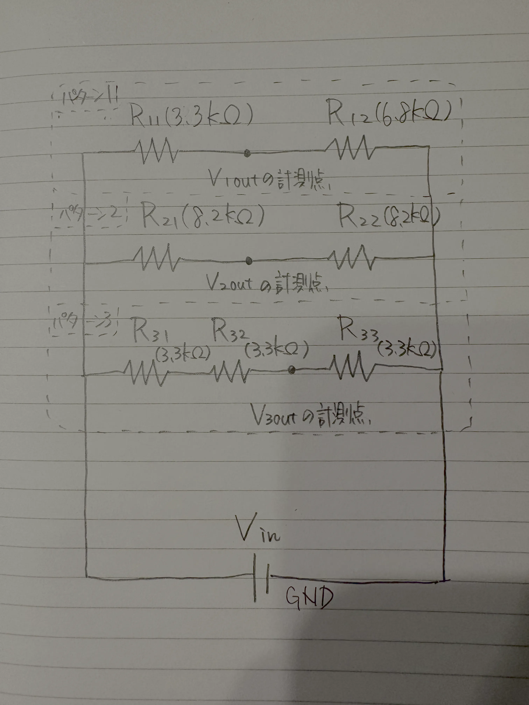
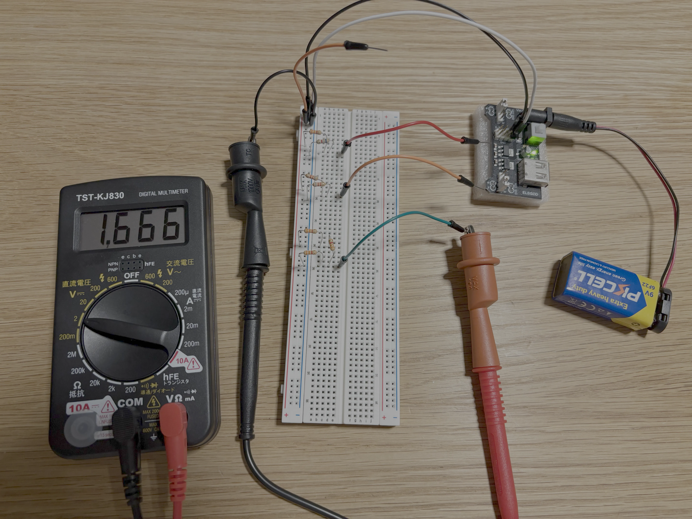

# 分圧

## 目的

直列につないだ抵抗の比を利用して目的の電圧を取り出すことを分圧と呼び、そのための回路を分圧回路と呼びます。
この実験では三つのパターンの分圧回路で得られる分圧を、まずは計算から求め、その後実測した値との比較を行います。
これにより、分圧の計算方法と、実測値の解釈の仕方を学びます。

## 回路図

この実験では次の三つの分圧回路を用意します。

- パターン 1: 抵抗 R_11 (3.3kΩ) と抵抗 R_12 (6.8kΩ) を直列につなぎ、R_11 へ直流電圧 V_in (5V) をかけて R_12 を GND へつなぐ。分圧 V_1outは R_11 と R_12 の間で取り出す。
- パターン 2: 抵抗 R_21 (6.8kΩ) と抵抗 R_22 (6.8kΩ) を直列につなぎ、R_21 へ直流電圧 V_in (5V) をかけて R_22 を GND へつなぐ。分圧 V_2out は R_21 と R_22 の間で取り出す。
- パターン 3: 抵抗 R_31 (3.3kΩ) と抵抗 R_32 (3.3kΩ) と抵抗 R_33 (3.3kΩ) を直列につなぎ、R_31 へ直流電圧 V_in (5V) をかけて R_33 を GND へつなぐ。分圧 V_3out は R_32 と R_33 の間で取り出す。

**NOTE**: R_11 などの記号の `_` より後ろは添字を表すこととします。

下記にこの三つのパターンを一つの回路にまとめた回路図を示します。

## 計算

一般に分圧回路で取り出せる分圧 V_out は供給電圧 V_in と抵抗値 R_1 と R_2 から V_out = V_in * R_2 / (R_1 + R_2) として計算できます。

このとき R_1 は供給電圧側、R_2 は GND 側の抵抗の値です。
これにより三つのパターンで取り出せる分圧 V_1out、V_2out、V_3out はそれぞれ次のように計算できます。

パターン 3 では分圧を取り出す位置が R_32 と R_33 の間なので、R_31 と R_32 を一つの抵抗とみなして計算できることに注意します。

- パターン 1 V_1out = V_in * R_12 / (R_11 + R_12) = 5V * 6.8kΩ / (3.3kΩ + 6.8kΩ) ~ 3.366V
- パターン 2 V_2out = V_in * R_22 / (R_21 + R_22) = 5V * 8.2kΩ / (8.2kΩ + 8.2kΩ) ~ 2.500V
- パターン 3 V_3out = V_in * R_33 / (R_31 + R_32 + R_33) = 5V * 3.3kΩ / (3.3kΩ + 3.3kΩ + 3.3kΩ) ~ 1.667V

## 実測

回路図をもとにブレッドボード上に分圧回路を実装したものの写真が下記になります。

三つの各パターンで取り出せる分圧のそれぞれ下記の値を表に記します。

- 計算値: 上述した計算による値
- Falstad の値: [Falstad](https://www.falstad.com/circuit/) を利用したシミュレーション結果の値
- 実測値（レンジ・精度の幅）: ブレッドボード上の実装をテスター (TST-KJ830) で計測した値。レンジはテスターをどのレンジで計測したか、精度の幅はテスターの直流電圧の精度である ±(0.6%rdg + 8dgt) を計算したものを示す
- 実測値と計算値の差: 実測値から計算値を引いた値

| パターン | 計算値 | Falstad の値 | 実測値 (レンジ・精度の幅) | 実測値と計算値の差
|---|---|---|---|---
| 1 | 3.366V | 3.366V | 3.35V (20V・±0.1001V) | -0.016V
| 2 | 2.5V | 2.5V | 2.48V (20V・±0.09488V) | -0.02V
| 3 | 1.667V | 1.667V | 1.666V (2V・±0.01800V) | -0.001V

上記の結果から次のことが分かりました。

- 分圧の計算値と Falstad によるシミュレーション結果は三つの全てのパターンにおいて一致していた。
- 分圧の実測値と計算値の差は、三つの全てのパターンにおいて、テスターの精度の幅に収まっていた。
